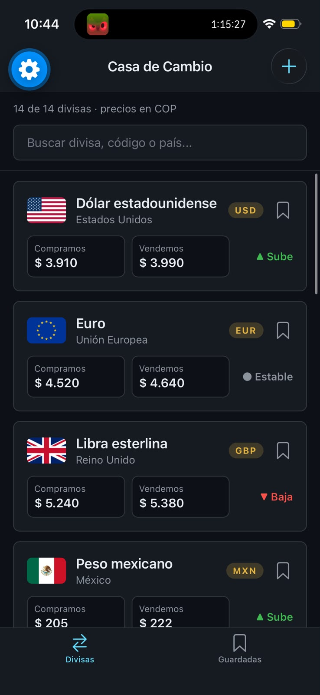
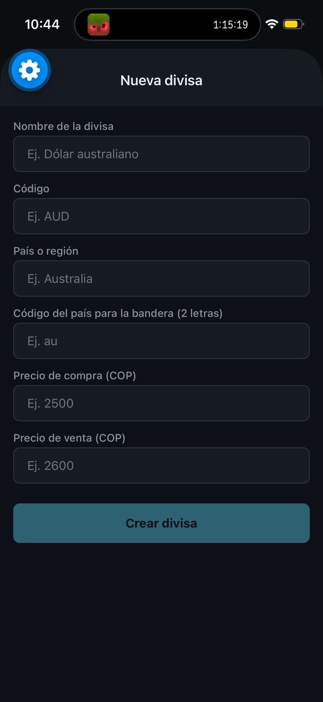
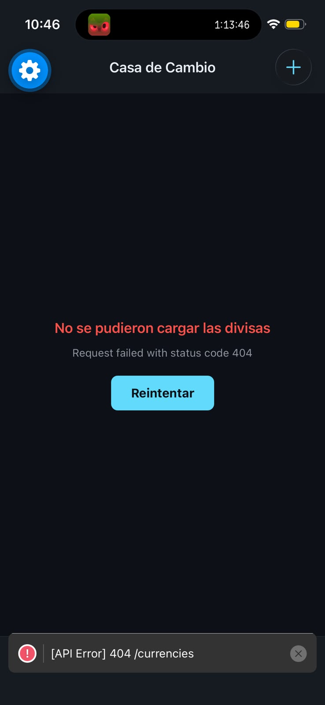

# Casa de Cambio — Semana 05 (Networking con Axios y TanStack Query)

**Bootcamp:** bc-reactnative · **Dominio:** Casa de cambio
**Entidades del dominio:** currencies, transactions, rates, clients
**Estudiante:** Leyner Buitrago

## Descripción del dominio

Una casa de cambio compra y vende divisas. La app consume una API REST propia (MockAPI, recurso
`currencies`) para listar las divisas con su precio de compra y de venta en pesos colombianos (COP),
buscarlas, ver su detalle, guardarlas y crear divisas nuevas.

## API utilizada

- **MockAPI**, con el recurso `currencies` (campos: `name`, `code`, `country`, `imageUri`,
  `buyRate`, `sellRate`, `trend`).
- Endpoints: `GET /currencies` y `POST /currencies`.

## Implementación de la semana 5

- **Instancia de Axios** en `src/services/api.ts`, con `baseURL`, `timeout`, headers y un interceptor
  de respuesta que registra los errores en desarrollo.
- **`QueryClientProvider`** en `App.tsx`, con una sola instancia de `QueryClient`.
- **`useCurrencies`** (`useQuery`) con la queryKey semántica `['currencies']`.
- **Estados de red en la lista:** `ActivityIndicator` mientras carga, mensaje con botón *Reintentar* si
  hay error y estado vacío con `ListEmptyComponent`.
- **Pull-to-refresh** con `refetch` y `isRefetching`.
- **`useCreateCurrency`** (`useMutation`): hace el POST e invalida `['currencies']` en `onSuccess`, así la
  lista se actualiza sola, sin recargar la app.
- **Estado del servidor vs. estado del cliente:** las divisas viven en TanStack Query; Zustand solo guarda
  los **ids** de las divisas guardadas. La pestaña Guardadas cruza ambos.
- TypeScript estricto, sin `any`.

## Capturas

| Lista | Crear divisa | Estado vacío |
|---|---|---|
|  |  |  |

## Cómo ejecutar

1. En `src/services/api.ts`, cambia `API_BASE_URL` por la URL base de tu proyecto en MockAPI.
2. Luego:

```bash
cd starter
pnpm install
pnpm start
```