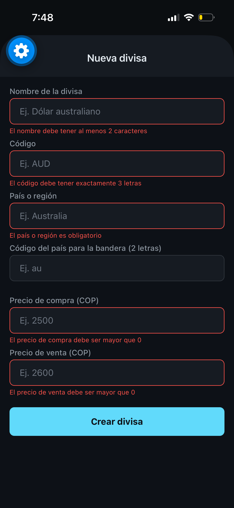
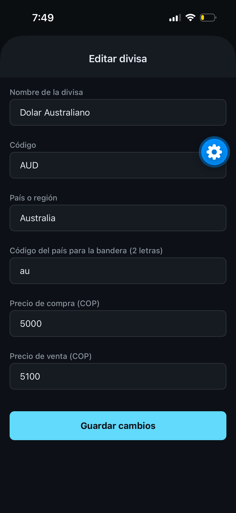
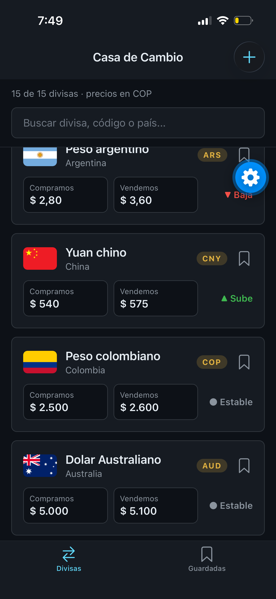

# Casa de Cambio — Semana 06 (Formularios con React Hook Form y Zod)

**Bootcamp:** bc-reactnative · **Dominio:** Casa de cambio
**Entidades del dominio:** currencies, transactions, rates, clients
**Estudiante:** Leyner Buitrago

## Descripción del dominio

Una casa de cambio compra y vende divisas. En esta semana la app suma formularios validados para
**crear** y **editar** una divisa (nombre, código, país, bandera y precios de compra y venta) conectados
a la API de la semana 5.

## Implementación de la semana 6

- **Schema Zod** (`src/schemas/currencySchema.ts`) adaptado al dominio y con mensajes de error en español.
- **Tipos inferidos del schema:** `z.input` (lo que escribe el usuario) y `z.infer` (lo ya validado). No
  hay una interfaz manual duplicada.
- **`FormField` genérico y reutilizable** (`src/components/FormField.tsx`): encapsula `Controller` +
  `TextInput` + mensaje de error, tipado con genéricos de React Hook Form, sin `any`.
- **`CreateScreen`:** `useForm` + `zodResolver`; al enviar, el POST se hace con `useCreateCurrency` y la
  pantalla vuelve atrás en `onSuccess`. El botón se deshabilita con spinner mientras se envía.
- **`EditScreen`:** carga la divisa del servidor con `useCurrencyById` y rellena el formulario con
  `reset()` dentro de un `useEffect`; guarda con `useUpdateCurrency` (PUT). El botón solo se habilita si
  hubo cambios (`isDirty`).
- La invalidación de `['currencies']` actualiza la lista y también cada divisa individual.

## Reglas de validación

| Campo | Regla |
|---|---|
| Nombre | 2 a 40 caracteres |
| Código | exactamente 3 letras (formato ISO 4217: USD, EUR…) |
| País o región | 2 a 40 caracteres |
| Bandera | 2 letras, o vacío para usar la bandera por defecto |
| Precio de compra | número mayor que 0 (`z.coerce.number()`) |
| Precio de venta | número mayor que 0 y no menor al precio de compra |

## Capturas

| Errores de validación | Editar divisa | Lista actualizada |
|---|---|---|
|  |  |  |

## Cómo ejecutar

1. En `src/services/api.ts`, cambia `API_BASE_URL` por la URL base de tu proyecto en MockAPI.
2. Luego:

```bash
cd starter
pnpm install
pnpm start
```