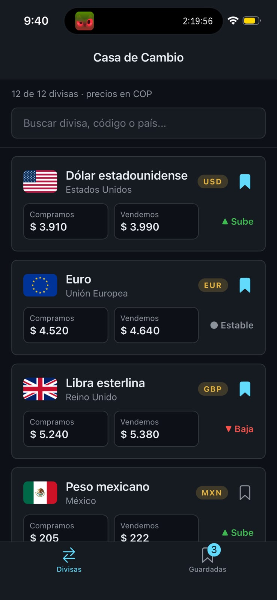
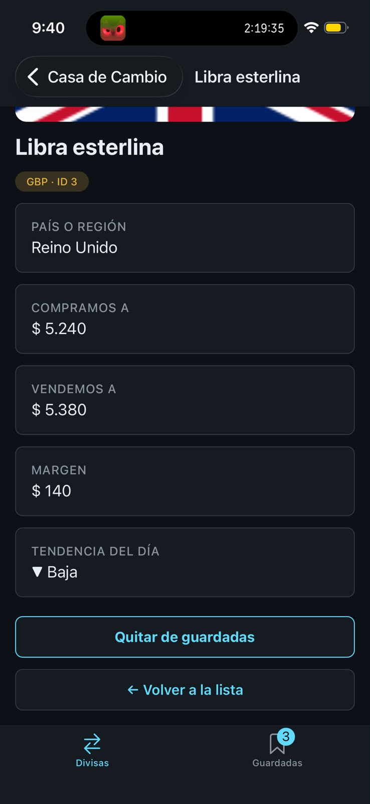
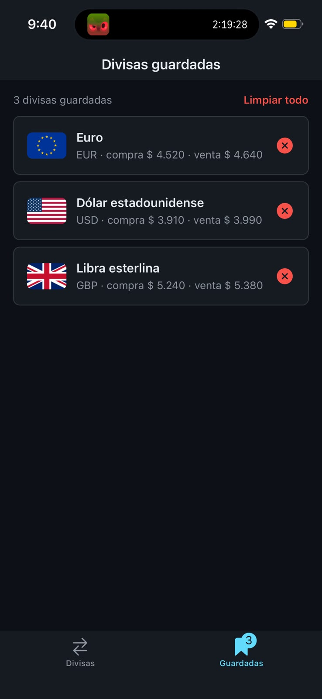

# Casa de Cambio — Semana 04 (Estado global con Zustand)

**Bootcamp:** bc-reactnative · **Dominio:** Casa de cambio
**Entidades del dominio:** currencies, transactions, rates, clients
**Estudiante:** Leyner Buitrago

## Descripción del dominio

Una casa de cambio compra y vende divisas. La app lista las divisas (currencies) con su precio de
compra y de venta en pesos colombianos (COP), permite buscarlas, ver su detalle y guardar las que
interesan. Las tasas son ficticias.

## Implementación de la semana 4

- **Store de Zustand** (`src/stores/savedStore.ts`) tipado con `create<SavedStore>()`: `items`,
  `addItem` (sin duplicados), `removeItem`, `isItemSaved` y, como extra, `clearAll`.
- **Selectores específicos:** cada componente lee solo lo que necesita, así que solo se re-renderiza
  cuando cambia ese dato.
- **Tarjeta y detalle:** un botón guarda o quita la divisa del store.
- **Pestaña Guardadas:** lista lo que hay en el store, permite quitar divisas y limpiar todo con
  confirmación.
- **Badge en la pestaña Guardadas:** muestra la cantidad en tiempo real y se oculta cuando no hay
  divisas guardadas.
- Navegación de la semana 3 (Tab + Stack con params tipados) y TypeScript estricto, sin `any`.

## Capturas

| Divisas | Detalle | Guardadas |
|---|---|---|
|  |  |  |

## Cómo ejecutar

```bash
cd starter
pnpm install
pnpm start
```